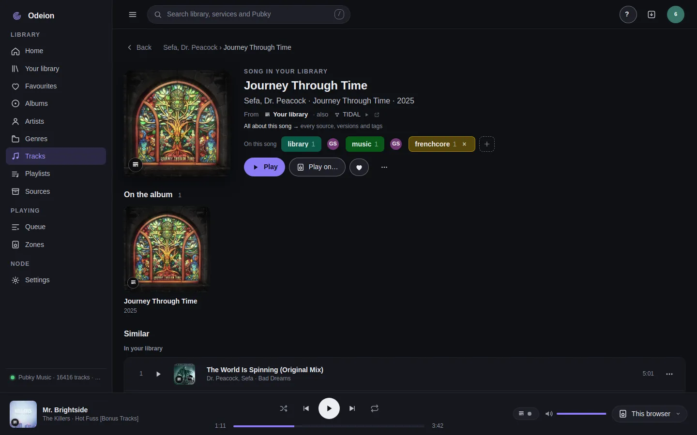
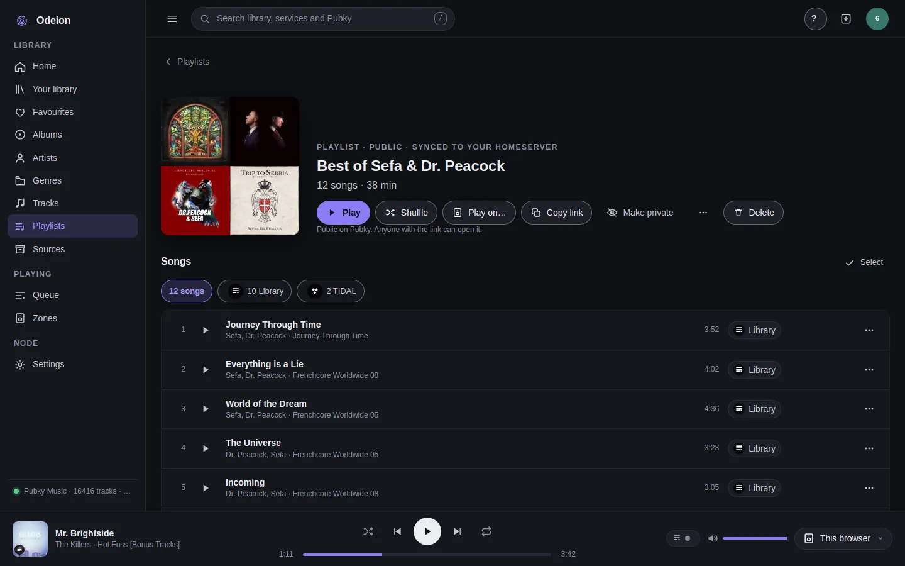
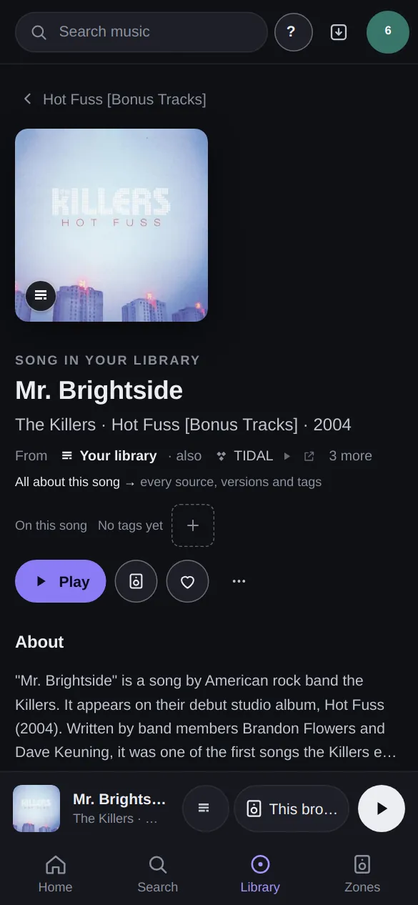
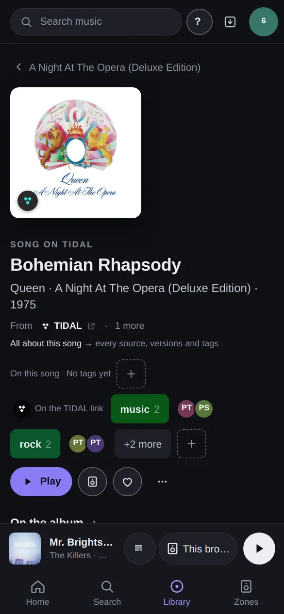

# Odeion

  

**Your own music server for the whole home.**

Odeion runs on a computer at home that stays on, such as a NAS, a mini PC or a Raspberry Pi. It
plays your music files and the streaming services you use (TIDAL, Qobuz, Spotify, internet radio
and more) on the speakers you already have, room by room, and on your phone or computer. With a
Pubky account your playlists, favourites and tags are kept in your own storage, and you see what
people on Pubky play and tag and where else a song can be found. You don't need to be a developer.

<table>
  <tr>
    <td> <b>Home:</b> what people on Pubky play</td>
    <td> <b>A song you have:</b> its tags on Pubky, and where else it is</td>
  </tr>
  <tr>
    <td> <b>A shared playlist,</b> kept on your homeserver</td>
    <td> <b>Now playing,</b> with the queue</td>
  </tr>
</table>

<table>
  <tr>
    <td> A song you have, also on TIDAL and three more</td>
    <td> Tags from people on Pubky</td>
    <td> Now playing on a phone</td>
  </tr>
</table>

Screenshots from a real library on the newest build (November 2026).

## Get started

| You have | Guide |
| :-- | :-- |
| A spare PC or mini PC to make an Odeion box (it erases its disk) | [Install from a USB stick](docs/guides/install-iso.md) |
| A NAS or server with Docker (Synology, QNAP, Unraid, TrueNAS, any Linux) | [Install with Docker](docs/guides/install-docker.md) |
| A Raspberry Pi or Linux machine without Docker | [Install on Linux](docs/guides/install-linux.md) |
| A phone or computer to listen on and control it | [The app](docs/guides/desktop-app.md) or [the web app](docs/guides/install-web-app.md) |

Then: [first steps after installing](docs/guides/overview.md#first-steps-after-installing). How it
all fits together, Pubky and Pinakes, and what works today: [Overview](docs/guides/overview.md).

## What you need

- **A computer that stays on**, on your home network. Docker makes it easiest (amd64 and arm64);
  the node also runs on Linux, macOS and Windows without Docker.
- **Your music** as files (FLAC, ALAC, WAV, AIFF, DSD, MP3, AAC, Ogg), streaming accounts, or both.
- **Something to play on**, on the same network: see [Speakers](docs/guides/speakers.md). A web
  browser works too.
- **Optional:** the Pubky Ring app for your Pubky account, and [external resources](docs/guides/overview.md#pinakes)
  (Pinakes, MusicBrainz, Wikipedia) for the social side, covers and facts.

## Downloads

The app, the node and the Odeion box installer, for the latest release and for edge (newest
code): [Downloads](docs/guides/overview.md#downloads), or
[GitHub releases](https://github.com/gillohner/odeion/releases).

## Help and feedback

- Something not working: [Troubleshooting](docs/guides/troubleshooting.md). Away from home:
  [Remote access](docs/guides/remote-access.md). Updates and backups:
  [Backups and updates](docs/guides/backup-and-update.md).
- Using someone else's node: tell its owner with **?** › **Report a problem…** in the top bar.
- Questions, bug reports and ideas: [GitHub issues](https://github.com/gillohner/odeion/issues).

## For developers

The node is `odeiond`, a Rust workspace. Build, config, API and design notes:
[For developers](docs/guides/overview.md#for-developers).
