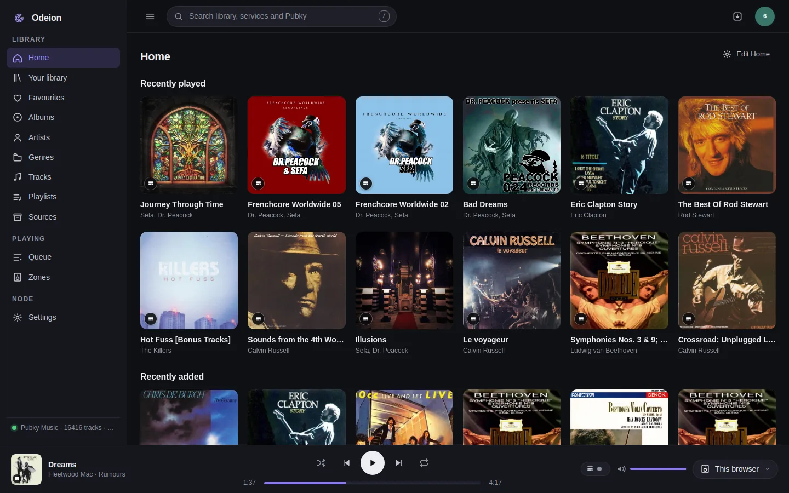
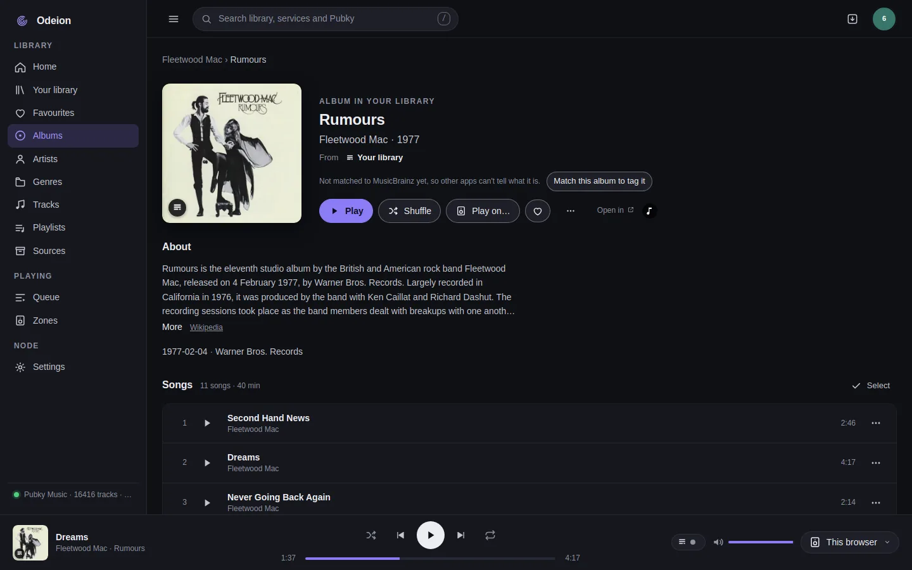
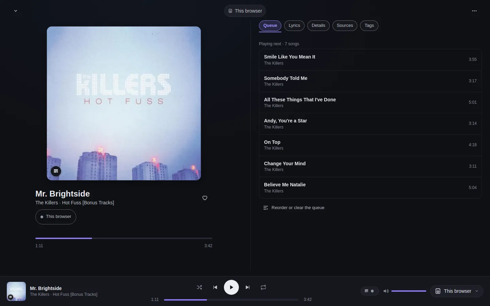
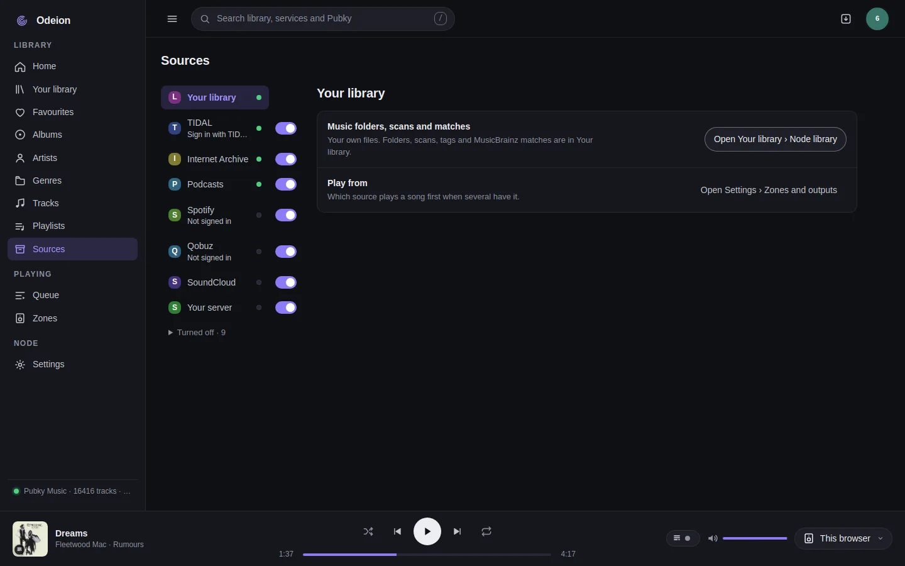
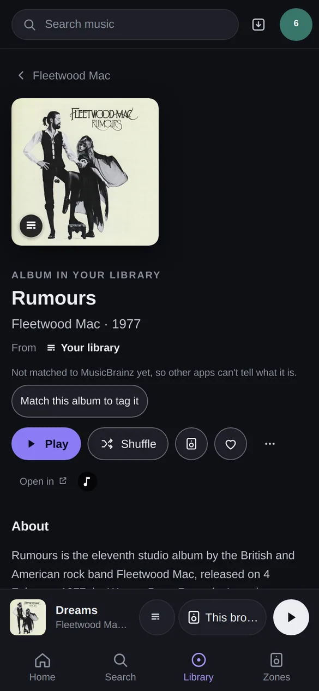
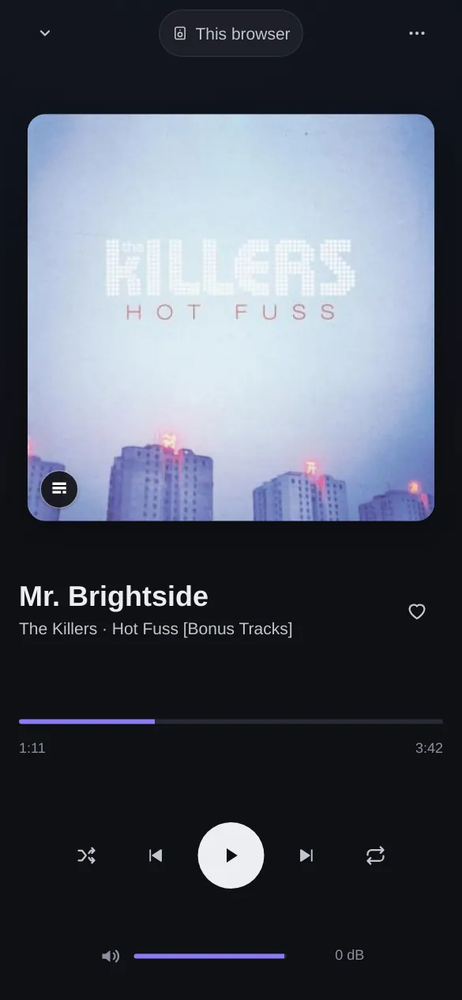
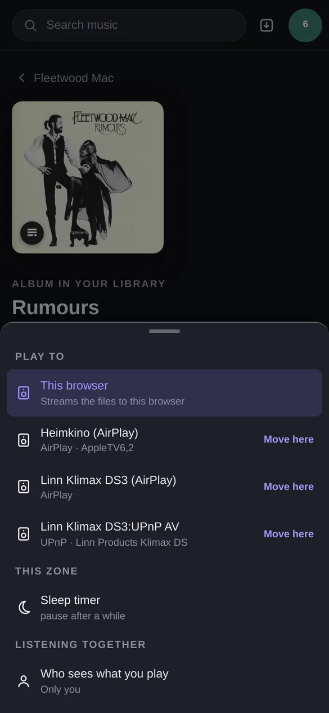

# Odeion

<p align="center">
  
</p>

**Your own music server for the whole home.**

Odeion runs on a computer at home that stays on, such as a NAS, a mini PC or a Raspberry Pi. It
plays your own music files and the streaming services you use (TIDAL, Qobuz, Spotify, internet
radio and more) on the speakers you already have, room by room, and on your phone or computer.
You control it from a web page, the Odeion app or a Subsonic app. With a Pubky account your
playlists, favourites and tags are kept in your own storage and follow you to a new node, and
Pinakes adds what people on Pubky play and where else a song can be found.

It is for people who are comfortable installing an app on a NAS and following a few steps. You
don't need to be a developer.

## Screenshots

From the newest build (November 2026), on a real library.

<table>
  <tr>
    <td><br><b>Home:</b> what you played and added lately</td>
    <td><br><b>An album:</b> play it, read about it, see where else it is</td>
  </tr>
  <tr>
    <td><br><b>Now playing</b>, with the queue</td>
    <td><br><b>Sources:</b> your files and the services you connect</td>
  </tr>
</table>

<table>
  <tr>
    <td><br>An album on a phone</td>
    <td><br>Now playing on a phone</td>
    <td><br><b>Play to:</b> pick a speaker</td>
  </tr>
</table>

## How it works

- **The node** is the server at home. It reads your music folders, signs in to your streaming
  services and sends the music to the speakers. Everything else talks to it.
- **To control it** you use the web page (it installs as an app on phones and computers), the
  Odeion app for macOS, Windows, Linux and Android, any OpenSubsonic app (Symfonium, Feishin,
  Amperfy), or Home Assistant.
- **Speakers:** most are found on your network by themselves: UPnP and DLNA streamers and TVs
  (Linn, WiiM, Naim and others), Sonos, HEOS, Bluesound, Chromecast, AirPlay and a DAC on the
  node's own machine. Squeezebox and squeezelite players are pointed at the node, and Snapcast and
  MPD are added in its config. The Odeion app and the browser can play too. Each speaker is a zone
  with its own queue, and zones can be grouped. Full list: [Speakers](docs/guides/speakers.md).
- **Sources** are your files (a local disk, a USB drive, a network share, Google Drive or
  OneDrive), files on your Pubky homeserver, internet radio and podcasts, and streaming services:
  TIDAL, Qobuz, Spotify, Deezer, the Internet Archive, Audius, Jamendo, SoundCloud, Bandcamp,
  YouTube, and your own Jellyfin, Plex, Subsonic or Audiobookshelf server. What each one needs:
  [Streaming services](docs/STREAMING-PROVIDERS.md).
- **Pubky** is your identity and your storage. You sign in with the Pubky Ring app. Playlists,
  favourites, tags and listening history are written to your Pubky homeserver, and the app uses it
  to find and reach your node from anywhere.
- **Pinakes** is a public index of the links people share on Pubky. Odeion asks it what people on
  Pubky play and tag, which public collections hold a song, and where else a song or album can be
  found. Artist photos and texts come from Wikipedia and Wikimedia Commons, and song and album
  facts from MusicBrainz.

## What you need

- **A computer that stays on**, on your home network: a NAS, a mini PC, a Raspberry Pi 4 or 5
  with a 64-bit system, or any Linux machine. Docker makes it easiest (images for amd64 and arm64).
  The node also runs without Docker on Linux (x86_64, arm64, armv7), macOS (Apple silicon) and
  Windows. A spare 64-bit Intel or AMD PC with 20 GB of disk can become an Odeion box with the
  USB-stick installer.
- **Your music** as files (FLAC, ALAC, WAV, AIFF, DSD, MP3, AAC, Ogg) in a folder that computer can
  read, or accounts with the streaming services you want to use, or both.
- **Something to play on:** see [Speakers](docs/guides/speakers.md). A web browser works too.
- **The node on the same network as your speakers.** In Docker that means host networking (the
  compose files in the guides do this).

### Pubky (optional, recommended)

[Pubky](https://pubky.org) is an open network where your identity is a key you hold and your data
lives on a homeserver you choose. For Odeion you need:

- **The Pubky Ring app** on your phone. It holds your Pubky identity, and you approve sign-ins
  with it: the node's own sign-in, and logging in to the web page and the app.
- **A homeserver for your account**, one of these:
  - **The node's own homeserver.** The USB-stick installer sets one up by default, and with Docker
    the bundle in [`deploy/bundle/`](deploy/bundle/) runs one next to the node. Your account, your
    playlists and any music files you copy there stay on your own machine. On the first start,
    **Settings › My accounts** offers **Create your Pubky account on this node’s homeserver**.
  - **An existing homeserver**, the one your Pubky account already uses. Sign the node in with
    **Settings › My accounts › Sign in with Pubky** and approve in Pubky Ring.

With Pubky you get: logging in with Pubky Ring instead of a token, inviting other people to your
node (each with their own sign-in), playlists, favourites, tags and history kept in your account,
public tags and shared playlists, and the Odeion app reaching the node away from home without any
router setup.

Without Pubky, the node still does all the music: library, speakers, streaming services, radio,
Subsonic apps and backups. You log in with the node's API token, playlists stay on the node, and
for access away from home you use Tailscale or a Cloudflare Tunnel
([Remote access](docs/guides/remote-access.md)).

### Pinakes (optional)

Pinakes is the music index Odeion reads for the social side. It is public, read-only and needs
no account. By default the node uses `https://8092--main--pinakes--gil.coder.riginode.xyz`, a
development instance run by the project's maintainer, so it can be slow or away at times.

These parts come from Pinakes:

- On Home, what people on Pubky play: trending songs, tags and your friends' picks.
- The **Pubky** results in search.
- **In collections** on song, album and artist pages: public collections that hold them.
- **Tagged alike on Pubky** under Similar.
- Part of the **Also on** links (the rest come from MusicBrainz), which also tell a playlist
  where else a song can play from.
- Titles and covers for web links kept in a playlist.
- Podcast search (when Pinakes has nothing, the node asks Apple's podcast directory).

Pinakes, MusicBrainz and Wikipedia each ask every app for a way to reach whoever runs it. So the
node asks for nothing from them until it has one: an email address or a website you add on Home's
**Get started** card or in **Settings › Discover**, or, when you sign the node in to Pubky and
gave none, your Pubky profile link. That also turns on Discover. It goes only to those services.

If Pinakes doesn't answer, everything else works; the app lists it under **External resources**
below the node's status. To use another Pinakes instance, add this to the node's config file
(`/data/node.toml` inside the Docker container, `/etc/pubky-music/node.toml` on Linux) and
restart the node:

```toml
[pubky]
pinakes_base = "https://pinakes.example.org"   # without /v1
```

Names and pictures of people, comments and who tagged what come from Nexus, Pubky's public index
(`https://nexus.staging.pubky.app` by default; `nexus_base` in the same section).

## Where it stands

As of November 2026. The last numbered release is **0.2.2** (30 October 2026), still under the
project's old name. **Edge** is built from every change to the code.

**Live in release 0.2.2**

- Library: folder scans, tags, covers, artist pages, search, play history, lyrics.
- Playback to every speaker kind listed above, grouped zones, per-zone EQ and other sound
  settings, internet radio. Bit-perfect by default, and the signal path shows every change made to
  the sound.
- Streaming sources, the desktop and Android app, Subsonic apps, Home Assistant.
- Pubky sign-in with Pubky Ring, playlists and favourites in your account, the bundle with its own
  homeserver, remote access through the app.

**Live on edge, not in a release yet**

- The Odeion name and logo, and the web page as an installable app.
- The USB-stick installer for an Odeion box.
- Each person signs in to their own TIDAL, Qobuz and Spotify; the node's owner chooses whose
  sign-ins people play with.
- TIDAL in lossless and hi-res with **Sign in with TIDAL**; Qobuz with just email and password.
- Android app: keeps playing in the background, updates itself, and plays bit-perfect to a USB DAC
  (Android 14 and later, or with its own USB driver on older phones). The USB DAC modes are still
  being tested on real phones.
- Quicker song identification, and reviewing its matches is optional.
- Copying library folders to your homeserver in the background.
- Tags in the top card of song, album and artist pages, drawn as in pubky.app.

**In progress**

- Android: the phone plays in the app itself, also away from home, with the phone's media
  controls and volume keys.
- Android: picking songs, albums and playlists to keep on the phone from their ⋯ menu, a storage
  screen, and playing them through the app's own player with no network.
- A redesigned phone layout: a simpler mini player, Now playing and list rows, with more swipes.
- Simpler sign-in pages for streaming services.
- People you invite keep their own bookmarks and playlists on their own homeserver.
- Reporting a problem from the app to the node's owner.
- Usage insights for the owner (off by default; the node's part is on edge, the recording part is
  not, so nothing is recorded yet). [How it works](docs/guides/usage-insights.md).
- Release images under the name `ghcr.io/gillohner/odeion` (until then releases are
  `ghcr.io/gillohner/pubky-music-node` and edge is `ghcr.io/gillohner/odeion:edge`), and the
  desktop app's installed name, which is still the old one.

What changed and when: [CHANGELOG](docs/CHANGELOG.md).

## Choose how to run it

| You have | Use | Guide |
| :-- | :-- | :-- |
| A spare PC or mini PC to make an Odeion box (it erases its disk) | the installer on a USB stick | [Install an Odeion box from a USB stick](docs/guides/install-iso.md) |
| A NAS or server with Docker (Synology, QNAP, Unraid, TrueNAS, any Linux) | the Docker image | [Install with Docker](docs/guides/install-docker.md) |
| A Raspberry Pi or Linux machine without Docker | the download and a system service | [Install on Linux without Docker](docs/guides/install-linux.md) |
| A Mac, Windows PC, Linux desktop or Android phone | the Odeion app, to control a node and play on that device | [The desktop and Android app](docs/guides/desktop-app.md) |
| A phone, tablet or computer with just a browser | the web app, installed from your node's page | [Install the web app](docs/guides/install-web-app.md) |
| A Raspberry Pi with a DAC, as a speaker for your node | squeezelite | [Speakers](docs/guides/speakers.md#a-raspberry-pi-with-a-dac-squeezelite) |

The app, the web app and squeezelite don't run a node themselves: install the node first, then
connect them to it. Umbrel isn't supported right now.

## First steps after installing

1. **Open the web page.** In a browser on the same network, go to `http://<node address>:7788`
   (for example `http://192.168.1.10:7788`; the box from the USB stick is at
   `http://odeion.local:7788`).
2. **Log in.** With Pubky Ring, once the node is signed in to Pubky (step 5). Before that, open
   **Use the node’s API token instead**, paste the token and press **Log in with the token**. The
   token is:
   - Odeion box: log in on the box's own screen as `odeion` with the password you chose, then
     run `sudo sed -n 's/^PM_TOKEN=//p' /opt/odeion/.env`.
   - Docker: the output of `docker exec pubky-music cat /data/api-token` (or `PM_TOKEN` if you set
     one; with the bundle, `PM_TOKEN` in `.env`).
   - Linux without Docker: the token the install printed, also in `/etc/pubky-music/node.toml`.

   Home's **Get started** card then lists what is left to do on this node, and only that.
3. **Add your music.** With Docker the node reads the music folder (`/music`) by itself.
   Otherwise go to **Your library › Node library** (or the Get started card), type the folder's
   path and press **Add folder**. New files show up about 15 seconds after they land.
4. **Pick a speaker.** The zone button at the right of the player bar says **This browser** at
   first. Press it and choose a speaker, then press play. All speakers the node found are in
   **Settings › Zones and outputs**. If one is missing, see [Speakers](docs/guides/speakers.md).
5. **Optional:**
   - Sign the node in to Pubky (see [Pubky](#pubky-optional-recommended) above).
   - Add an email address or website in **Settings › Discover** to turn on Discover.
   - Connect streaming services under **Sources**, and internet radio under **Radio**.
   - Invite people, or start a party link for guests, in **Settings › People**.

## Away from home

Once the node is signed in to Pubky, the Odeion app reaches it from anywhere through an encrypted
peer-to-peer link. Nothing to open on your router. For a browser or Subsonic apps away from home,
use Tailscale or a Cloudflare Tunnel. Don't forward port 7788 to the internet. See
[Remote access](docs/guides/remote-access.md).

## Updates and backups

- **Update:** with Docker, pull the new image and recreate the container. The box from the USB
  stick installs Debian's security updates by itself; Odeion is updated with a few commands on its
  console ([guide](docs/guides/install-iso.md#updating-odeion)). The desktop and Android app ask
  when a new version is out.
- **Back up:** **Settings › Backup** makes one file with your library data, playlists, favourites,
  history and settings (never your music files), and can do it every day or week. With the node's
  own homeserver, `deploy/bundle/backup.sh` backs up the node and the homeserver together.

Details: [Backups and updates](docs/guides/backup-and-update.md).

## Downloads

| | Latest release (0.2.2) | Edge (newest code) |
| :-- | :-- | :-- |
| All files | [releases/latest](https://github.com/gillohner/odeion/releases/latest) | [releases/tag/edge](https://github.com/gillohner/odeion/releases/tag/edge) |
| macOS (universal) | [.dmg](https://github.com/gillohner/odeion/releases/latest/download/pubky-music-macos-universal.dmg) | [.dmg](https://github.com/gillohner/odeion/releases/download/edge/pubky-music-macos-universal.dmg) |
| Windows | [setup .exe](https://github.com/gillohner/odeion/releases/latest/download/pubky-music-windows-x86_64-setup.exe) | [setup .exe](https://github.com/gillohner/odeion/releases/download/edge/pubky-music-windows-x86_64-setup.exe) |
| Linux x86_64 | [.AppImage](https://github.com/gillohner/odeion/releases/latest/download/pubky-music-linux-x86_64.AppImage), [.deb](https://github.com/gillohner/odeion/releases/latest/download/pubky-music-linux-x86_64.deb) | [.AppImage](https://github.com/gillohner/odeion/releases/download/edge/pubky-music-linux-x86_64.AppImage), [.deb](https://github.com/gillohner/odeion/releases/download/edge/pubky-music-linux-x86_64.deb) |
| Linux arm64 | [.AppImage](https://github.com/gillohner/odeion/releases/latest/download/pubky-music-linux-arm64.AppImage), [.deb](https://github.com/gillohner/odeion/releases/latest/download/pubky-music-linux-arm64.deb) | [.AppImage](https://github.com/gillohner/odeion/releases/download/edge/pubky-music-linux-arm64.AppImage), [.deb](https://github.com/gillohner/odeion/releases/download/edge/pubky-music-linux-arm64.deb) |
| Android and Google TV | [arm64 .apk](https://github.com/gillohner/odeion/releases/latest/download/pubky-music-android-arm64.apk) | [arm64 .apk](https://github.com/gillohner/odeion/releases/download/edge/pubky-music-android-arm64.apk) |
| Odeion box installer | not in a release yet | [odeion-edge-amd64.iso](https://github.com/gillohner/odeion/releases/download/edge/odeion-edge-amd64.iso) |
| The node, without Docker | `pubky-music-node-linux-{x86_64,arm64,armv7}.tar.gz`, `…-windows-x86_64.zip`, `…-macos-arm64.tar.gz` | the same names under edge |
| Docker image | `ghcr.io/gillohner/pubky-music-node:latest` | `ghcr.io/gillohner/odeion:edge` |

Every release has a `SHA256SUMS` file to check downloads against.

## Help and feedback

- Something not working: [Troubleshooting](docs/guides/troubleshooting.md).
- Questions, bug reports and ideas: [GitHub issues](https://github.com/gillohner/odeion/issues).
  Include how you installed it, the version (**Settings › About and updates**) and the node's log
  ([where to find it](docs/guides/troubleshooting.md)).

## For developers

- Build and run from source, every config option and all deployment shapes:
  [docs/deploy.md](docs/deploy.md).
- HTTP and WebSocket API: [docs/api.md](docs/api.md). Connection and discovery:
  [docs/CONNECTION.md](docs/CONNECTION.md). Zones and outputs: [docs/ZONES.md](docs/ZONES.md).
- Design decisions: [docs/adr/](docs/adr/). Releases: [docs/RELEASING.md](docs/RELEASING.md).
  The app: [crates/pm-desktop/README.md](crates/pm-desktop/README.md).
- Pinakes and Odeion: [docs/PINAKES-CONTEXT.md](docs/PINAKES-CONTEXT.md).
- Odeion had another name before; what kept the old name and why:
  [docs/branding-compatibility.md](docs/branding-compatibility.md).

```sh
cargo test --workspace
cargo clippy --workspace --all-targets -- -D warnings
cargo build --release -p pm-node --features alsa   # needs libasound2-dev; builds odeiond and pm-node
```

The workspace is Rust: `pm-node` builds the node (`odeiond`, and `pm-node`, its old name), `pm-api`
the HTTP API and web UI, `pm-library` the library, `pm-zones` and `pm-audio` playback, `pm-out-*`
the speaker protocols, `pm-pubky` the Pubky and Pinakes side, and `pm-desktop` the app (not a
workspace member). Every outbound request names the node and its contact; MusicBrainz is asked at
most once a second, and Pinakes lookups are batched. No copyrighted audio is ever written under a
public `/pub/` path.
